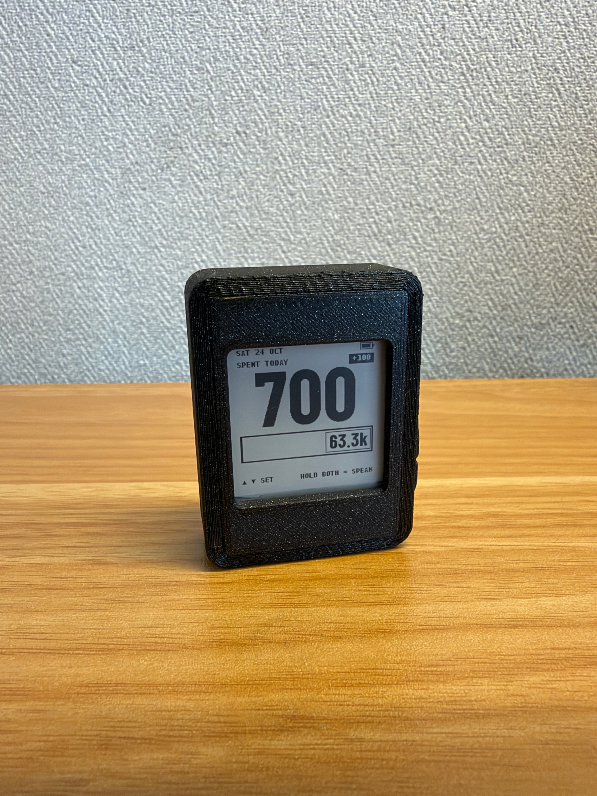

# SpendBox

**A pocket-sized e-paper gadget that tells you how much you can still spend today, and lets you log a purchase with two buttons in a few seconds.**

<!-- Add your own photo here:   -->

I built this to understand where my money really goes and to budget better. Budgeting apps failed me for one reason: opening the app, typing the number and picking a name was annoying enough that I stopped logging. SpendBox removes that friction: the purchase is entered with **two buttons**, the device **shows your remaining daily limit at a glance**, and it sleeps between presses so a small battery can last a long time.


## What it does

- **Shows one number: what you have spent today**, plus a bar for what is left of today's limit and the days until payday.
- **Daily limit = the most you can spend today while still affording a minimum amount of food for every remaining day until payday.** It counts your balance, upcoming bills and the credit left on your card.
- **Log a purchase in a few seconds:** press up/down to dial the amount, hold both buttons, pick a category, hold both again. Done.
- **Cash or card:** the device tracks how much credit your card has left and knows when it resets on the bill day. Some categories (train fares, utilities, small shops) can be marked "cash only".
- **Set it up from your phone:** hold both buttons for 3 seconds and the device becomes a Wi-Fi hotspot with a small website for your balance, bills, payday, categories and ledger. No app, no cloud, no account. Your data stays on the device.
- **Built for low power:** the screen keeps its picture with no power, the board deep-sleeps between presses, and Wi-Fi is on only in sync mode. (Real battery life is not measured yet; see Status.)

## What you need

| Part | Notes |
|---|---|
| Waveshare **ESP32-S3 1.54" e-Paper AIoT board (V2)** | the main board; it already has the screen, two buttons, clock chip and battery charger |
| 3.7 V LiPo battery, e.g. **652540 800 mAh** | with a protection circuit; check the plug polarity matches the board before connecting |
| USB-C **data** cable | for flashing and charging |
| 3D-printed case (optional) | files in [`hardware/case`](hardware/case) |

No soldering and no extra wiring. See the [build guide](docs/build-guide.md).

## Quick start (5 minutes, nothing to install)

1. Download [`prebuilt/spendbox-merged.bin`](prebuilt/spendbox-merged.bin).
2. Put the board into download mode: unplug USB, hold **BOOT**, plug in, release.
3. In desktop Chrome or Edge open <https://espressif.github.io/esptool-js/>, click **Connect**, choose the board, set the flash address to `0x0`, choose the file, click **Program**.
4. Unplug and replug the cable. The screen shows today's date and a big 0.
5. Hold **both buttons for 3 seconds** to open sync mode, scan the QR code with your phone, open `http://192.168.4.1` and walk through the 5 setup steps.

Details and troubleshooting: [docs/build-guide.md](docs/build-guide.md). To build from source instead, see the same guide.

## How to use it

| You do | What happens |
|---|---|
| Press **BOOT** (up) / **PWR** (down) | amount goes up / down by your step (default 100). Hold to go 5× faster. The amount is a draft until you save it. |
| Hold **both** buttons ~1 s (with an amount) | the category list opens. Up/down to choose, hold both ~1 s to save. |
| Quick tap of **both** (with an amount) | switches this one purchase between card and cash (only if your card still has credit) |
| Hold **both** ~3 s on the home screen (no amount) | sync mode: the phone setup website |
| Hold **both** again in sync mode | leaves sync mode and goes home |

Full guide with pictures of each screen: [docs/user-guide.md](docs/user-guide.md).

## How it works

[docs/how-it-works.md](docs/how-it-works.md) explains the budget formula, the card-credit rules, how data is stored so it lasts years, and how the power design reaches weeks of battery life.

## Repository layout

```
core/        portable C code with no hardware access: budget maths, ledger, categories, button gestures, UI state machine,
             drawing code (core/gfx). Runs on the board and on a PC for tests.
firmware/    ESP-IDF project for the ESP32-S3: display driver, flash storage, Wi-Fi hotspot and website, main loop
hardware/    case files
prebuilt/    ready-to-flash firmware image
docs/        guides
tools/       font generator and screenshot helper
```

## Tests

```
make test       # 199 checks on the budget maths, gestures, UI and drawing; runs on any computer with a C compiler
make screens    # redraw docs/images/screen-*.png from the real drawing code (needs Python + Pillow)
```

## Status and limitations

- Built and used on the V2 board. Other boards need changes to the pin numbers in `firmware/main/pins.h` and the display driver.
- **Voice input is not implemented.** The code has hooks for it (`firmware/main/hal_voice.c`), but categories are chosen with the buttons. Contributions welcome.
- The device shows no currency sign, so it works with any currency (whole units only).
- Battery life depends on how often you use it and on the board's sleep current; measure it on your unit.
- The sync website has no password of its own. It is protected by the hotspot's WPA2 password, which is shown only on the device screen while sync mode is on, and the hotspot closes by itself.

## Contributing

Issues and pull requests are welcome. Please run `make test` before sending a change. See [docs/development.md](docs/development.md).

## License

MIT, see [LICENSE](LICENSE). Third-party parts are listed in [THIRD_PARTY.md](THIRD_PARTY.md).
