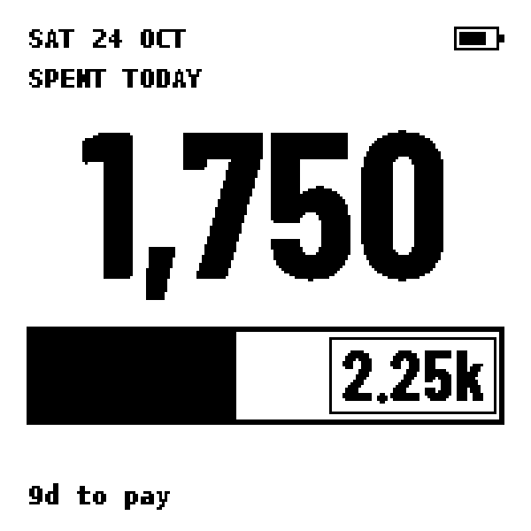
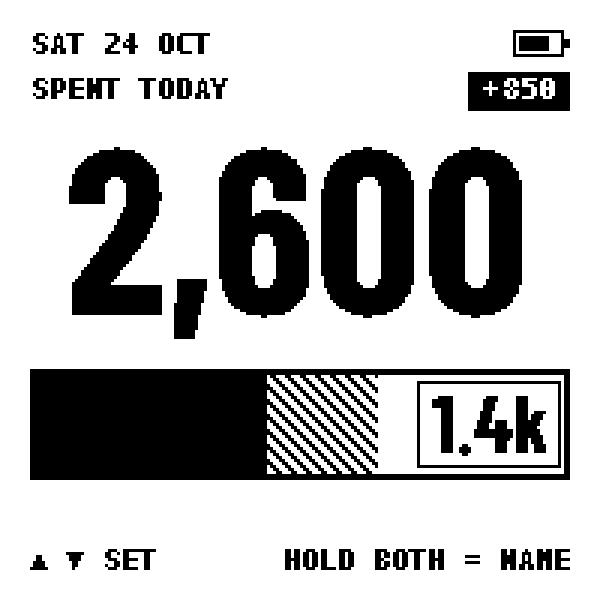
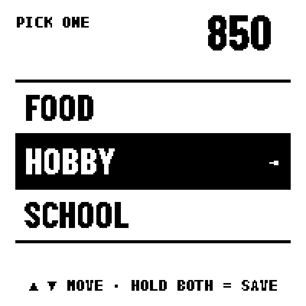
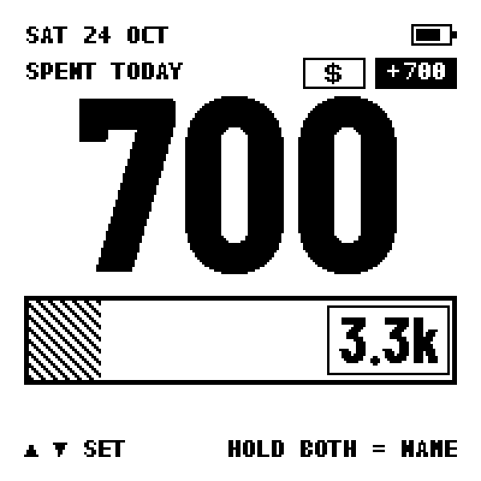
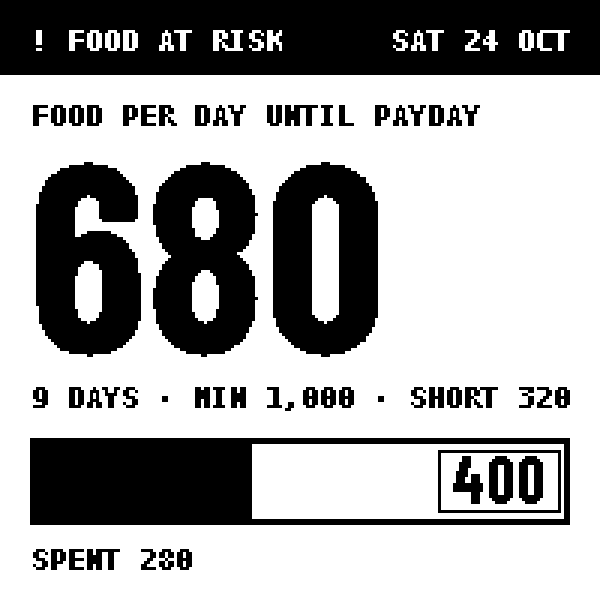
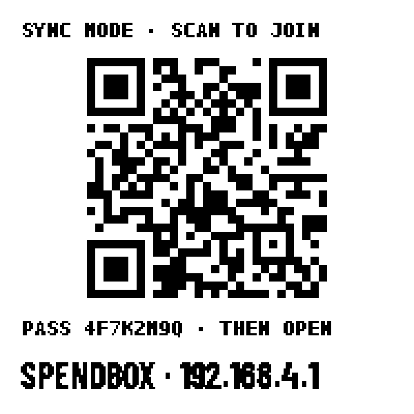

# User guide

SpendBox has **two buttons**. Everything is done with them, except the one-time setup, which is done from your phone.

- **BOOT** button = **up** (add to the amount)
- **PWR** button = **down** (take away from the amount)

(The labels are printed on the board.)

## The home screen

| Part | Meaning |
|---|---|
| Big number | what you have spent **today** (saved purchases plus the draft you are typing) |
| Bar | today's limit. Black = already spent, hatched = the draft you have not saved yet, white = still free |
| Box on the bar | how much you can still spend today |
| `9d to pay` | days until payday |
| Date and battery | top of the screen |

The device shows **no currency sign**; use whatever currency you like, in whole units.

## Logging a purchase

1. **Dial the amount.** Press up/down. Each press changes it by your *step* (default 100, change it on the website). Hold a button and it counts **5× faster**, stopping where you let go.
   A small tag at the top right (`+850`) shows the draft. Nothing is saved yet.

   

2. **Hold both buttons for about 1 second.** The category list opens.

   

3. **Up/down to choose** the category, then **hold both buttons for about 1 second** to save. The screen returns home with the new total.

If you dialed a **negative** amount it is saved as a **mistake**, which takes it back out of today's total.

### Cash or card

If you track a credit card, the device assumes **card** while the card still has credit, and **cash** once the credit has run out. Categories ticked **Cash only** on the website (train fares, utilities, small shops) are always cash.

- To pay one purchase the other way: before step 2, **tap both buttons quickly** once. A small `$` sign appears next to the amount. Tap again to remove it.
- When the card has no credit left, everything is cash and the tap does nothing.

### Over the limit and "food at risk"

If you spend more than today's limit the bar is full and the remaining number goes negative. If your money is not enough to keep the minimum amount of food for every remaining day, the screen shows **FOOD AT RISK** with how much you are short.

## Sync mode: the phone website

Hold **both buttons for about 3 seconds on the home screen** (with no amount typed).

1. The device becomes a Wi-Fi hotspot named **SPENDBOX**. Scan the QR code with your phone's camera and join. If you type it by hand, the password is shown on the screen.
2. Open **http://192.168.4.1** (some phones open it by themselves).
3. Tabs along the bottom: **Upcoming** (bills, days to payday, set the clock), **Ledger** (your latest purchases), **Limit** (correct the balance, see where the money goes), **Settings** (the 5 setup steps).
4. Sync mode ends by itself after you save, when nothing happens for a while, or after 10 minutes. You can also **hold both buttons again** to leave it right away.

Scan the QR code from straight in front of the screen; at a steep angle it may not read.

### The 5 setup steps

| Step | What you enter |
|---|---|
| 1. Money now | your real balance (look in your bank app), credit left on your card, and the credit you get back after paying the card |
| 2. Bills before payday | each bill or saving with its date and amount. Tick *Estimate* if unsure and *pays my credit card* for the card bill |
| 3. Rules | payday (day of month, optionally moved to Monday if on a weekend), minimum food per day, amount per button press |
| 4. Categories | up to 5 names (max 8 letters/digits). Tick *Cash only* where needed. Removing one keeps your history |
| 5. All set | the numbers the device will use. Press **Done** |

Every step saves on its own, so you can stop at any step.

## Running on the battery

- **Switch on:** with USB unplugged, hold **PWR** for about 3 seconds until the screen refreshes, then let go. After that the board sleeps and wakes on every button press by itself.
- **Charging:** plug in a USB-C cable. The board's charge LED shows when it is charging.
- **Battery icon:** the icon at the top right shows the charge. With no battery fitted it always shows full.

## Good to know

- **The clock.** A real-time clock chip keeps the date. If the battery ever dies completely the clock may be lost; the screen then says **SET CLOCK**. Set it from the **Upcoming** tab of the website.
- **Low battery.** Below about 3.2 V sync mode is refused and the screen says **CHARGE FIRST**. Entering purchases still works. Charge with a normal USB-C charger.
- **Your data** is stored in the device's flash memory (about 16,000 purchases, oldest overwritten first). Nothing leaves the device.
